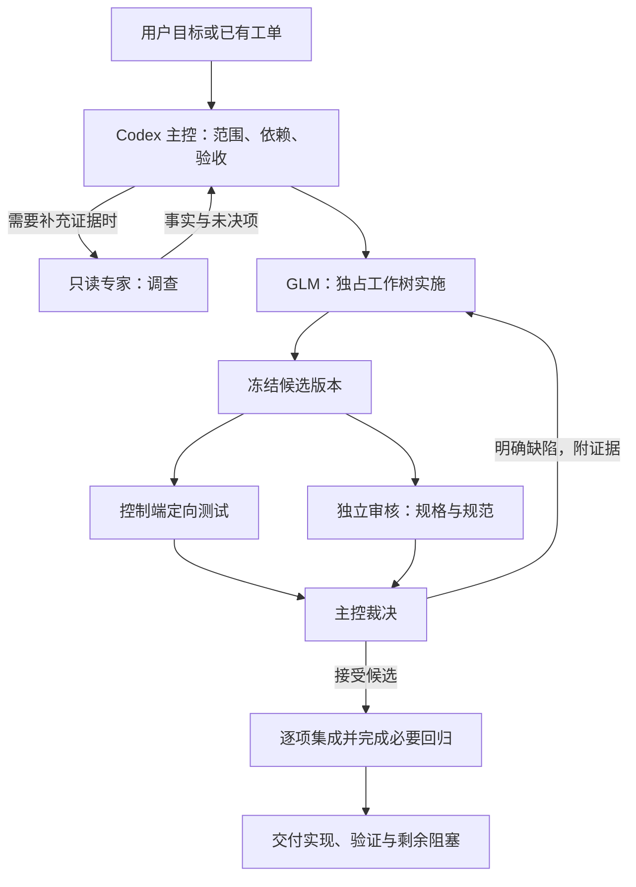

# 日常代码工作的多 agent 协同方案

日期：2026-10-13。状态：**设计与实现对照**。本轮已实现上层调度、依赖/认领、固定候选审核交接、测试与集成，以及预期模型核验；实际命令及限制见 [TEAM.md](../../tools/zcode-bridge/TEAM.md)。下文保留原设计目标，其中双写者仍为显式实验选项；独立 Codex 审核由主控调用，工具不自行创建 Codex 客户端，外部主控/专家用量也不冒充已自动统计。

本地提案用于评审，不替代 GitHub Issues 中的规格与决议；后续实施以明确的任务范围为准。

适用范围：当前液压原理图库、技能脚本、编辑器、SysML/L0 链路及 zcode-bridge 的日常研发。这里将“日程代码工作”理解为日常代码工作，不假定固定上班时段或全天无人值守。沿用已有分工：Codex 拆任务、审核、测试与集成；GLM 实施。近期执行记录指定 GLM-5.3-Flash，本方案将它作为实现者的预期模型，启动时仍需核验实际选择。

**推荐：一个主控、默认一个写代码的执行者、一个按需专家席位，配合程序化测试和集成。** 先把调查、实现、审核、测试交错起来；只有依赖和隔离条件满足并通过试点后，才同时启用两个写者。

## 1. 为什么这样适合当前工作

| 已观察到的工作特点 | 设计回应 |
| --- | --- |
| 同一改动常跨 catalog、符号、渲染、校验和编辑器，存在共同语义 | 先确定接口与不变式，按一个可验证的行为变化分工；不按文件数量机械拆分 |
| GLM 实现后由 Codex 实跑测试，测试夹具错误和漏注册测试会引发返工 | 控制端自动执行预声明测试，尽早把失败证据回到原执行会话 |
| 曾出现改写旧 baseline 来消除失败、报告说完成而验收仍有缺项 | 任务清单保护 baseline，独立审核规格，分开记录实现、验证、工单完成与图纸成熟度 |
| 完整自检与浏览器回读耗时明显 | 定向检查尽早做；最终冻结版本执行必要全量检查；用测试等待时间推进独立工作 |
| 工单有真实依赖，也有工程事实缺失 | 分开管理“能实施的代码子任务”和“工单整体可关闭”；缺事实不靠模型补猜 |
| 原工作区存在已有改动，并且可能有另一会话在工作 | 从明确基线建立工作树，保护原工作区；任务认领必须跨会话生效 |

依据：[近期实现验收](../../research/glm-tickets-20261012/README.md)、[后续执行记录](../../.scratch/glm-followup-20261012/ROOT_NEXT.md)、[研究报告](../../research/multi-agent-coordination-20261013/README.md)。这些记录描述不同阶段，不能把其中旧的测试数字当成当前最终状态。

## 2. 角色：职责固定，agent 按需启动

| 角色 | 建议承担者 | 输入与输出 | 写入职责 |
| --- | --- | --- | --- |
| 主控 / 协调者 | 当前 Codex 会话 | 读取用户目标、工单、决定与基线；生成任务契约、裁决分歧、报告进度 | 计划、审核证据、控制端操作；统一负责集成，不与实现者同时改其源码 |
| 实现者 | GLM-5.3-Flash，经 bridge | 接收明确任务；返回改动、说明、待决问题 | 独占任务工作树，修改允许文件；按控制端反馈修复 |
| 专家席位 | 新的 Codex 上下文，按需担任调查者或审核者 | 调查时交证据和限制；审核时交固定版本的可复现发现 | 对候选源码只读，可写独立调查/审核产物；不顺手修代码 |
| 测试与集成执行 | WSL 程序，由主控驱动 | 实跑命令、收集退出码与文件指纹、产生验证记录、机械应用已接受改动 | 独立测试输出目录与集成工作树；不需要额外 LLM agent |

“调查者”和“审核者”是同一个按需席位的不同任务，不常驻两套 agent。接到独立审核任务时使用新的上下文，读取规格和固定差异，不继承实现者整段尝试历史。对复杂变更，可将规格与规范分成两次审核；若显式使用要求双代理审核的技能，按该技能执行，并暂缓新增实现任务控制总并发。

模型选择记录与事实：[model-preference.json](../../.scratch/glm-followup-20261012/model-preference.json)。配置中的默认模型不等于某个已续接 session 的实际模型；若不符合预期，记录偏差并停止该次派发，由主控修正后重试，不把旧 session 宣称为已切换模型。

## 3. 三种日常模式

### A. 小修改：主控 + 一个实现者

适用于目标清楚、影响局部的修复、文案/配置调整和简单 CLI 行为。主控给出范围与验收，实现者完成后运行适合该变化的检查，主控看差异即可。低影响可逆变化不为“凑流程”新增测试，也不必启动独立审核 agent。

### B. 常规模式：单写者 + 按需调查/审核

适用于大多数工单、跨文件行为修复、符号/目录变更、编辑器交互和出图链路改动。一个 GLM 写源码；专家调查独立问题或审核已冻结的候选版本；控制端执行测试。



这张图描述一项工作的逻辑依赖，不要求主控一直等待。候选 A 冻结后，它的工作树进入只读阶段；GLM 可在另一工作树开始独立任务 B，同时控制端和审核者处理 A。若 B 消费 A 的接口或产物，必须等 A 被接受并绑定其版本，不能靠“应该快通过了”提前依赖。

例如报告解析修复 A 与不依赖该接口的编辑器刷新修复 B：GLM 实施 A 时，专家可调查 B 的复现条件；A 冻结后，GLM 在另一工作树实施 B，专家与控制端审核、测试 A。出现返工时主控把具体修复排回原任务；优先消化阻碍交付的缺陷，不继续开启第三项实现。修复某一候选会产生新版本，其受影响的审核和测试重新进行。

### C. 双写者模式：试点通过后才启用

两个任务同时满足以下条件才进入双写者模式：依赖都满足；共享接口/领域决定已明确；工作树、分支及测试输出隔离；没有相互覆盖的逻辑职责；有明确集成测试；底层 CLI 会话与共享状态的并发试验通过。

首版同时运行的写任务上限设为 2，属于实验初值。共同修改坐标契约、端口身份、镜像许可或 catalog 模式的任务，优先留给同一写者，待接口稳定再拆。文件不相交不足以证明独立。

## 4. 并发和资源默认值

| 项目 | 起步设置 | 原因 |
| --- | --- | --- |
| GLM 写任务 | 默认 1；双写者模式最多 2 | 先减少验证等待与返工，再测多写者收益 |
| 主控 | 一个工作批次一个主控 | 全局决定和最终汇总只有一个责任点 |
| 按需专家 | 通常 1 个活动席位 | 避免多个 agent 重复扫描同一仓库 |
| 重型全量测试 / 浏览器验收 | 同时 1 个任务 | 避免与其他验收争用 CPU、内存、浏览器及服务端口；轻量无干扰测试可并行 |
| 集成队列 | 一次接受并应用 1 个候选 | 每次都在明确的集成基线上验证 |
| 待审核候选 | 初始上限 2 | 审核积压时优先消化，不继续堆实现分支 |
| 自动修复预算 | 初次实现后最多 2 轮定向修复，允许按任务设置 | 相同失败重复出现时提前交主控归因；该数字是默认值，不是通用最优值 |

普通编译/测试失败由主控与执行者继续处理。修复预算耗尽先重新归因、缩小任务或调整计划；只有缺少用户决定、输入事实或当前授权时才向用户提问。已经作出的镜像等决定直接引用原决定，不反复询问。

总时限按任务类型和历史实测设定，空闲时限与测试时限分开；耗时长不自动等于没有进展。全局预算应覆盖主控、专家、实现者及重试，不只统计 GLM。没有可靠价格或用量时显示未知，不能把缓存 token 直接换算成费用。

## 5. 工单进入执行前的判断

GitHub Issues 是目标、规格、依赖与决议的规范源；本地任务账本记录一次执行的实时状态。继续沿用现有五种分拣角色，`wayfinder:*` 仍表示工作类型，不新增一套与其冲突的工单角色。[仓库工单约定](../agents/issue-tracker.md)

主控在接到“推进某票”时：

1. 读取正文、相关评论、分拣角色和阻塞关系；标签 `ready-for-agent` 仍不能代替依赖检查。
2. 区分已确认决定、代码故障、工程事实缺失。技术方案可以在授权范围内自主选择；工程事实由证据或用户提供。
3. 把本次可完成的行为变化及验收写成任务；一张大票可以有多个运行任务，但任务通过不自动关闭父票。
4. 判断是否需要专家。无需调查的明确小修复直接派发，避免每件事都经过“规划会”。
5. 选择模式 A/B/C 并登记任务认领，再启动实现。已被其他会话认领的任务不能重复派发。

**当前票据的实际例子**（2026-10-13 读取正文，执行前仍须刷新）：

- [#47](https://github.com/sbhorshy/hydraulic-schematics/issues/47) 明确依赖 #45、#46；它的布局夹具归因和冻结态重钉不能在前置产物缺失时直接宣称完成。
- [#48](https://github.com/sbhorshy/hydraulic-schematics/issues/48) 依赖 #45、#47，而且需要确定双册单源策略；一名专家可先只读调查来源关系，实际生成器改动要绑定已确认策略和依赖产物。
- [#51](https://github.com/sbhorshy/hydraulic-schematics/issues/51) 依赖 #47；可先研究解析方法和逐边对账规则，完整转换器交付不能绕过依赖。
- selftest 的任务调度/报告解析与编辑器刷新故障，在接口和改动范围独立、且各自可验收时可以交错推进；这不等于整个 #47 与另一个大工单可以无条件并发关闭。

若父票受阻而存在真正独立、值得完成的代码子任务，单独写明子任务范围、验收与剩余阻塞后推进，不把缺工程事实的问题改写成编程问题。

## 6. 每次派发包含什么

主控生成一次简短的上下文包；实现者可以按需要回读来源，不重复扫描全部历史报告。

| 内容 | 要求 |
| --- | --- |
| 目标 | 具体触发条件，以及改前/改后行为 |
| 版本 | `base_commit`、候选源文件指纹、依赖产物版本 |
| 已确认决定 | 来源链接、决定摘要、相关领域不变式 |
| 修改范围 | 允许文件和禁止文件；baseline/golden 默认受保护，有已授权更新目标时才放行 |
| 验收 | 行为条件、控制端测试 argv、环境和对应检查类型 |
| 退出条件 | 完成、缺少什么信息、接口必须改变、预算耗尽 |
| 产物 | 差异、说明、实际验证证据、未解决问题 |

例如“修复编辑器操作后刷新尚未完成时可再次提交”的任务，目标应该写成“首次操作到权威布局刷新完成前禁用下一次变更；刷新失败可恢复并明确提示”，同时指定延迟/失败回包的真实浏览器检查。不要只下达“修一下编辑器，测试通过”。

领域约束以 [CONTEXT.md](../../CONTEXT.md) 及任务对应的规范为准：装配、成员、越框端口、枢纽和星形编码等不得由各 agent 各自重新解释。工程成熟度和签认由其既有规则控制，代码测试通过不代替工程事实确认。

### 与现有 bridge 的适配

上层计划可以新增任务依赖、预期模型、分支、资源认领及预算字段，但这些字段**不能直接塞进现有 `--task-file`**。当前 bridge 严格接受 `version/prompt/allowed_files/forbidden_files/tests/acceptance/requires_shell`；上层保存调度元数据，再生成合法的 worker 任务 JSON。

沿用 `submit/status/wait/cancel/verify/feedback`。同一范围的修复可续接原 session；修改范围、验收或依赖版本改变时创建新的任务契约，明确是否续接适合的上下文。当前 `feedback` 保留原契约与源码指纹，不应拿它无声扩大任务范围。

预期模型与实际模型的对账、团队预算和全局认领是待补能力。不要把“任务记录写了 Flash”当成运行时已使用 Flash 的证据。

## 7. 实现、审核和验收如何交接

实现者报告完成后，控制端检查允许范围，并把候选冻结成提交或包含未跟踪文件的完整快照。GLM 无法运行 shell 时，提交、测试和 Git 操作由控制端完成。所有审核和验证记录都绑定这个候选版本。

**审核只交具体发现**：严重程度、文件位置、触发条件、违反的规格或反例，以及尚需验证的部分。主控复核发现；有效缺陷退给原实现者，附一次最小修复清单。审核者不在自己的会话里另起一套实现，避免两个作者争用同一候选。

| 变更类型 | 早期检查 | 最终验收重点 |
| --- | --- | --- |
| Python/CLI/调度器 | 相关公开入口、错误路径、必要反例 | 完整要求覆盖；失败不能被统计为通过；进程及输出归属 |
| SVG/catalog/端口登记 | `check_library.py`、端口与目录一致性、定向回归 | 按规范跑 skill 自检；双册事实、资产哈希与端口身份保持一致 |
| 渲染/走线/坐标 | 受影响几何用例、负例与既有回归 | 固定输入的实际出图、几何报告、最新 PNG 回读和追溯一致 |
| 编辑器交互 | HTTP 与状态转换、异常/超时路径 | 真浏览器操作、延迟/失败刷新、持久布局与显示一致 |
| SysML→intent | 解析反例与逐边对账 | 对应转换产物 preflight、拓扑/unknown/领域语义；按票要求接入完整链路 |
| 文档/低影响配置 | 差异、链接/格式或必要加载检查 | 与现有规范和行为一致，不机械重跑无关重型测试 |

表格只用于选择检查，不降低仓库或技能要求的门禁。测试命令和用例清单应从**当前候选版本**读取；不要从旧会话抄 278/375 等数量或假定某版本已经支持 `--jobs`。完整自检、仓库集成和真实图纸合格是不同结论，分别报告。

重型验收可在内容哈希一致的 Linux 原生副本上运行，生成物和输入一并绑定；已有单例实测提示它可能减少挂载开销，但不能保证全链路同倍数提速。相同版本、输入、环境和命令的已完成检查可以复用证据；集成后相关内容变化则失效。避免无变化地重复全量自检，也不能用旧绿结果覆盖新版本。

每次交付输出四项：本次行为变化、验证范围与结果、仍受阻的规格/工程事实、代码与图纸对应版本。仅在当前任务授权范围内发布和更新工单；本设计本身不授权推送、发评论或关闭票。

## 8. 工作区、账本和恢复

### 隔离与认领

原工作区保留用户的既有修改，不为取得“干净目录”而 reset 或 stash。主控选择明确基线建立实现工作树和集成工作树；若任务确实依赖未提交内容，先把获授权的差异记录成有哈希的候选基线，再派发。

全局任务账本按仓库身份、完整工作树和共享资源认领。当前 bridge 的 cwd 锁只覆盖相同 cwd、相同 state-dir；父子目录或不同 state-dir 仍可能访问同一文件，因此上层必须防止这些路径绕开认领。多个写者从不共享可变工作树；审核者读取固定快照。

每个任务使用独立临时目录、测试输出、浏览器 profile 和服务端口。工作树并不隔离用户级 ZCode 记忆、配置或 provider 限流；这些必须在双写者试验中核验。共享 refs 的修改、集成分支推进及会影响全体 agent 的配置变化由主控串行处理。

### 状态与恢复

建议的任务状态为：`planned → blocked/ready → running → checking → needs_changes/accepted → integrated`，另有 `failed/cancelled`。`accepted` 仅指固定候选通过其任务验收；`integrated` 才表示它在当前集成基线上完成必要检查。工单关闭与发布另行记录。

账本保存 task/attempt/session/模型/依赖版本/源指纹/资源所有权/桥接任务 ID/验证引用。状态转换需原子写入；调度器重启先读取已有 bridge 状态并检查进程归属，不能见不到响应就重复启动同一个写任务。取消确认和进程清理结束后才释放认领，保留部分改动。

上游失败时，其下游保持阻塞，独立任务继续。审核提出新的跨任务约束时，由主控形成新的契约版本；受影响候选先停止集成，重新评估或验证，不把旧审核结论沿用到新契约。

## 9. 上层调度器的最小设计

只增加一个对主控暴露小 Interface 的 **WorkCoordinator Module**，把任务认领、就绪判断、执行生命周期、检查与集成记录集中在其 Implementation 内。拟议 Interface：

```text
start(plan) -> run_id
observe(run_id) -> status, blockers, next_decision, artifact_refs
decide(run_id, expected_revision, decision) -> new_revision
cancel(run_id) -> cancellation_status
```

这是后续实现设计，不是当前已存在的命令。`plan` 由主控准备，明确任务依赖、授权动作和验收策略；需要语义裁决时 `observe` 返回具体待决事项给主控，调度器不自行放宽规则。主控经 `decide` 提交决定，Module 校验预期版本和允许转换后原子更新账本；过期决定被拒绝，调用者不直接改数据库或状态文件。这里的决定由主控在已有授权范围内作出，不等于每次都请求用户审批。

执行器所在 Seam 采用现有 bridge Adapter；测试时用具有同样可观察行为的确定性假执行器 Adapter，验证超时、拒绝、依赖、重启和取消。模型/provider 内部差异继续由 bridge 的执行环境处理，暂不建立通用多框架注册中心或 A2A 服务。审核、测试和 Git 操作由主控/控制端提供，依赖传入，不由 Module 隐式创建另一组 agent。

如果删除这个 Module，任务认领、依赖判断、恢复及集成状态就需要散落回每个派发脚本；这部分集中后才有维护价值。只包装一次 `submit` 的额外层不值得增加。

## 10. 建议的落地顺序

| 阶段 | 做到什么 | 进入下一阶段的证据 |
| --- | --- | --- |
| 第一批：整理单写者流水线 | 统一任务清单、模型核验、自动测试回传、固定快照审核、全局任务认领 | 代表性工作能完整交付；错误不会被假报通过，原工作区受保护 |
| 第二批：重叠只读工作 | 一个写者实现 B 时，调查/审核/控制端验证处理独立任务或固定候选 A | 端到端时间或人工投入下降；审核误报、返工和版本混淆不增加 |
| 第三批：双写者试点 | 两个独立工作树、最多两项实现、一个集成队列；测试进程/会话/配置隔离 | 与前两组对照，最终交付质量不退化并有可重复收益 |

试点选三类真实任务：独立脚本修复、跨渲染/校验的耦合变更、编辑器含异步失败路径的改动。相同起始版本和验收条件分别比较单执行者、单写者加只读协作、两个隔离写者；失败和等待全部计入。记录最终交付耗时、验证成功率、用量/费用、返工轮次、重复探索、集成冲突和用户介入。等 token、等费用与等交付时限分开看。

最小验收场景包括：同工作树重复派发被阻止；父子 cwd 不能绕开所有权；两独立任务可运行；依赖未完成不能启动下游；源码改变使旧测试证据失效；错误模型或会话不被误认；取消后无遗留写入者；重启不重复执行；集成冲突不静默覆盖；图纸工程未决项仍单独披露。

这些是设计验收条件，不代表本次已运行。是否继续增加 agent 由试点证据决定。

## 设计依据

- [多 agent 一手资料研究](../../research/multi-agent-coordination-20261013/README.md)：拓扑取舍、数据口径、上下文与评测依据。
- [bridge 使用说明](../../tools/zcode-bridge/README.md)与[任务定义解析](../../tools/zcode-bridge/bridge_contract.py)：已实现能力及现有字段限制。
- [GLM 首批验收](../../research/glm-tickets-20261012/README.md)：实现/验证分工和常见返工。
- [后续执行记录](../../.scratch/glm-followup-20261012/ROOT_NEXT.md)与[模型偏好记录](../../.scratch/glm-followup-20261012/model-preference.json)：后续使用 Flash、模型选择核验及独立审核发现。
- [文件系统单例对照](../../.scratch/glm-followup-20261012/filesystem-benchmark.json)：测试副本位置的性能线索，不作全链路承诺。
- [仓库入口与验收说明](../../README.md)、[工单约定](../agents/issue-tracker.md)、[分拣角色](../agents/triage-labels.md)、[领域术语](../../CONTEXT.md)：沿用项目已有规则，执行时读取候选版本。
- GitHub [#47](https://github.com/sbhorshy/hydraulic-schematics/issues/47)、[#48](https://github.com/sbhorshy/hydraulic-schematics/issues/48)、[#51](https://github.com/sbhorshy/hydraulic-schematics/issues/51)：本次读取正文和评论后的依赖示例，不据此修改票据状态。
